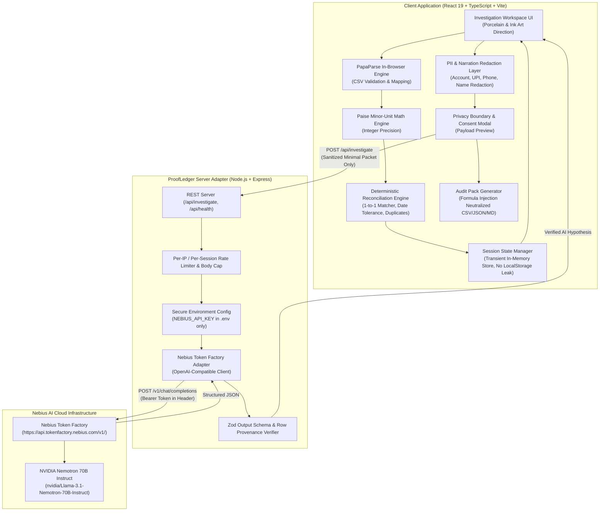
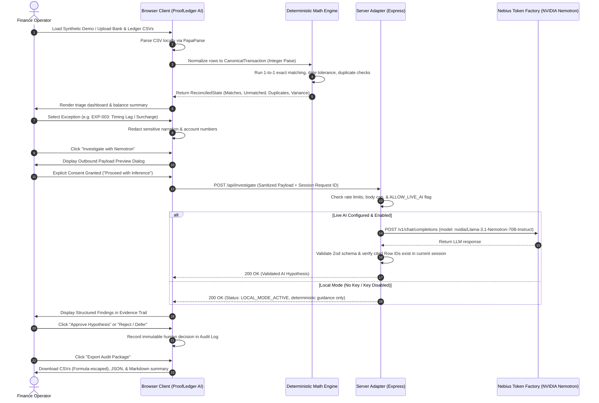

# System Architecture & Technical Specification — ProofLedger AI

**Product:** ProofLedger AI  
**Author:** Principal Product Engineer & AI Agent Architect  
**Track:** Best Apps & Agents — Nebius × NVIDIA Global AI Hackathon 2026  
**License:** MIT  

---

## 1. Architectural Philosophy

ProofLedger AI is built upon the foundational principle:
> **"Deterministic Financial Truth, AI-Assisted Investigation, Human-Controlled Resolution."**

To maintain absolute mathematical integrity and satisfy stringent enterprise data sovereignty:
1. **Client-Side Data Gravity:** The user's financial statements (Bank CSV and Accounting Ledger CSV) are parsed, validated, and normalized entirely inside the client browser. No raw financial data is ever transmitted to backend servers or third-party cloud services.
2. **Integer Minor-Unit Arithmetic:** All currency calculations (balances, debits, credits, variances) are computed in integer paise (INR minor units) or cents, completely eliminating IEEE-754 binary floating-point rounding errors.
3. **Isolated, Minimized AI Payload:** Nebius Token Factory (`nvidia/Llama-3.1-Nemotron-70B-Instruct`) is invoked **only** on demand for specific flagged exceptions, transmitting a sanitized, anonymized payload stripped of identifiable account numbers, phone numbers, and full names.
4. **Zod Runtime Schema & Provenance Guard:** Every AI response is validated at runtime using Zod. Any invented row IDs, hallucinated financial totals, or ungrounded claims are automatically caught, logged, and rejected.

---

## 2. High-Level Component Architecture

---

## 3. Data Flow & Sequence Diagram

---

## 4. Key Subsystems & Implementation Details

### 4.1 Paise Decimal-Safe Money Math (`src/lib/money/`)
- Monetary amounts are parsed from raw CSV strings (`"₹12,450.50"`, `"-1,200"`, `"1200.00"`) into signed 64-bit safe integers representing **paise** (1 INR = 100 paise).
- Floating point operators (`+`, `-`, `*`, `/` on floats) are strictly forbidden in balance or matching calculations.
- Functions:
  - `parseToPaise(val: string): number`
  - `formatPaise(paise: number, currency = 'INR'): string`
  - `calculateVariancePaise(bankTotalPaise: number, ledgerTotalPaise: number): number`

### 4.2 Deterministic Matching Engine (`src/lib/reconciliation/`)
- Multi-tier matching pipeline:
  1. **Reference + Amount Exact Match:** Same normalized UTR/Ref and equal signed amount within $\pm 4$ days tolerance.
  2. **Amount + Close Date Match:** Equal signed amount with 0 or 1 day date difference and high token overlap in description.
  3. **Duplicate Detection:** Scans for multiple records in the same source sharing amount and date.
  4. **Ambiguity Prevention:** If multiple candidates tie for a bank record, none are automatically confirmed; all are routed to the Ambiguous queue.
  5. **1-to-1 Consumption:** A `Set<string>` tracks consumed row IDs, guaranteeing that no transaction is ever reconciled twice.

### 4.3 Redaction & Privacy Engine (`src/lib/privacy/`)
- Regular expressions strip or mask:
  - Bank Account Numbers (`\b\d{9,18}\b` $\to$ `[ACCT-REDACTED]`)
  - UPI IDs (`[\w.-]+@[\w.-]+` $\to$ `[UPI-REDACTED]`)
  - Phone Numbers (`\b(?:\+91|0)?[6-9]\d{9}\b` $\to$ `[PHONE-REDACTED]`)
  - Email Addresses (`[a-zA-Z0-9._%+-]+@[a-zA-Z0-9.-]+\.[a-zA-Z]{2,}` $\to$ `[EMAIL-REDACTED]`)

### 4.4 Formula Injection Escaping (`src/lib/csv/export.ts`)
- Prevents CSV Injection / Formula Execution (CWE-1236) in Excel/LibreOffice.
- Any text cell beginning with `=`, `+`, `-`, or `@` has an apostrophe (`'`) prepended so spreadsheet software renders it as text rather than evaluating executable formulas. Valid negative numbers in numeric columns remain intact.

---

## 5. Deployment Architecture (Zero-Cost Free Tier)

| Component | Target Platform | Free Tier Guarantee | Notes |
| :--- | :--- | :--- | :--- |
| **Frontend UI** | Vercel / Cloudflare Pages / Local | 100% Free Tier | Static SPA bundle, fast global CDN |
| **Backend Adapter** | Node.js Express / Vercel Serverless Function | 100% Free Tier | Handles `/api/investigate` and `/api/health` |
| **Inference** | Nebius Token Factory | Hackathon Credits / API Key | Serverless endpoint, zero idle cost |
