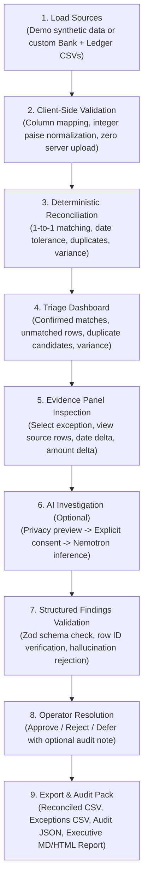

# Product Requirements Document (PRD) — ProofLedger AI

**Product Name:** ProofLedger AI  
**Track:** Best Apps & Agents (Nebius × NVIDIA Global AI Hackathon 2026)  
**Status:** Implemented & Verified  
**Date:** October 18, 2026  
**License:** MIT  

---

## 1. Executive Summary & Thesis

### 1.1 The Core Problem
Small business finance operators and finance teams face significant friction during month-end closing:
- Reconciling bank statement CSV exports against internal accounting ledger CSV exports (e.g., from Tally, QuickBooks, Zoho Books, or custom billing engines).
- Sorting through dozens or hundreds of lines to identify missing receipts, unauthorized charges, date timing lags (e.g., clearing delays over weekends), duplicate transactions, and amount mismatches (fees, GST adjustments, forex differentials).
- Generic AI chatbots fail because language models cannot do reliable arithmetic or guarantee row provenance; relying on LLMs for calculations leads to hallucinations and audit failures.
- Cloud-based enterprise reconciliation systems cost thousands of dollars per month, require complex ERP integrations, and ingest entire unredacted bank ledgers into third-party cloud databases—violating data sovereignty and customer privacy.

### 1.2 The ProofLedger AI Thesis
> **"Deterministic financial truth, AI-assisted investigation, human-controlled resolution."**

ProofLedger AI is a **privacy-first reconciliation investigation workspace**. It separates mathematical truth from natural-language reasoning:
1. **Deterministic Financial Engine:** Executes in the browser/client in pure TypeScript. Performs exact integer minor-unit (paise for INR / cents for USD) matching, date-tolerance scoring, duplicate candidate detection, and net balance variance calculations. **The AI never touches calculations or confirms ledger matches.**
2. **Targeted AI Investigation Agent:** When a human operator encounters an ambiguous or discordant exception (e.g., an unexplained ₹1,250 bank fee, a 4-day clearance discrepancy, or competing duplicate payouts), the operator can invoke the **NVIDIA Nemotron** agent via Nebius Token Factory. The system transmits only an anonymized, minimal evidence packet for that specific exception—never the raw CSV or unrelated records.
3. **Human-in-the-Loop Audit Trail:** The agent provides structured hypotheses, citing only genuine source row IDs with confidence and uncertainty levels. The operator explicitly reviews, approves, rejects, or defers the suggestion, generating an immutable, exportable audit trail.

---

## 2. Target Persona & User Journey

### 2.1 Persona: The Small-Business Finance Operator
- **Name:** Priya Sharma, Finance & Operations Lead at Northstar Studio (creative & design agency, 15 staff).
- **Workflow:** Receives monthly HDFC/ICICI bank statement CSV and an export from QuickBooks/Tally.
- **Pain Points:** 
  - Spent 4 hours hunting down a ₹240 discrepancy caused by a split payment and bank convenience surcharge.
  - Anxious about uploading client-confidential financial statements to cloud AI tools.
  - Needs a verifiable record of why specific adjustments were made for the statutory auditor.

### 2.2 End-to-End User Journey


---

## 3. Product Scope & Prioritization (P0 / P1 / P2)

| Priority | Feature Area | Description | Implementation Status |
| :--- | :--- | :--- | :--- |
| **P0** | **Client-Side CSV Parsing** | In-browser parsing (PapaParse) for Bank & Ledger CSVs. Flexible column detection (Date, Description, Amount, Debit, Credit, Reference). Downloadable templates. | **Built & Tested** |
| **P0** | **Paise/Cent Money Engine** | Decimal-safe integer minor-unit math. Zero floating-point rounding errors. Mixed currency rejection. | **Built & Tested** |
| **P0** | **Deterministic Matcher** | 1-to-1 row consumption. Exact reference + amount, date tolerance matching, candidate scoring, duplicate detection, variance computation. | **Built & Tested** |
| **P0** | **Financial Workspace UI** | High-fidelity light-first fintech workspace: porcelain canvas (`#F6F7F2`), deep navy rail (`#101A2B`), electric chartreuse accents (`#D7FF56`), semantic status badges. | **Built & Tested** |
| **P0** | **Synthetic Demo Dataset** | "Northstar Studio — September Close" scenario with 32 bank rows & 30 ledger rows covering all exception types. | **Built & Tested** |
| **P0** | **Zero-Upload Privacy** | Raw CSVs never leave browser session memory. Privacy-first architecture. | **Built & Tested** |
| **P0** | **Nebius Server Adapter** | Server-side proxy for Nebius Token Factory (`nvidia/Llama-3.1-Nemotron-70B-Instruct`). Zero API key leak to browser. | **Built & Tested** |
| **P0** | **Zod Schema & Citation Guard** | Runtime validation of AI output. Rejects hallucinated row IDs, invalid classifications, or unsupported claims. | **Built & Tested** |
| **P0** | **Audit Trail & Decisioning** | Operator approval/rejection/deferral of AI hypotheses. Non-destructive, append-only review state. | **Built & Tested** |
| **P0** | **Audit Exports & CSV Sanitization** | Export Reconciled CSV, Exceptions CSV, Audit JSON, and Markdown Report. Neutralizes spreadsheet formula injection (`=`, `+`, `-`, `@`). | **Built & Tested** |
| **P1** | **Privacy Payload Preview** | Interactive modal showing the exact JSON payload sent to Nebius before user consent. | **Built & Tested** |
| **P1** | **Column Mapping Editor** | Interactive UI for manual column assignment if auto-detection fails. | **Built & Tested** |
| **P1** | **Interactive Search & Filter** | Real-time filtering by status (Confirmed, Unmatched Bank, Unmatched Ledger, Discrepancy, Ambiguous) and search. | **Built & Tested** |
| **P2** | **Dark Mode Switch** | High-contrast dark theme for evening financial operations. | Backlog / Future |
| **P2** | **Direct ERP Sync** | Native OAuth connections to Tally / QuickBooks / Zoho Books. | Explicit Non-Goal |

### 3.3 Explicit Non-Goals
1. **No "Autonomous AI Accountant":** The system will never write to bank accounts, move money, or approve ledger entries without human confirmation.
2. **No Fictitious Bank Plaid/API Integrations:** We do not simulate or fake OAuth connections to real banking institutions. The product operates on standard CSV exports.
3. **No Unbounded General Chat:** No floating chat widget discussing general topics. AI is strictly confined to investigating specific financial exceptions.
4. **No Statutory Certification:** Does not claim to replace statutory financial audits or tax filings.

---

## 4. Functional Specifications

### 4.1 Canonical Data Schema
Every transaction from either source is mapped to a canonical TypeScript model:
```typescript
interface CanonicalTransaction {
  id: string;              // e.g. "BNK-001" or "LDG-001"
  source: 'bank' | 'ledger';
  sourceRowNumber: number; // 1-indexed row in original CSV
  date: string;            // ISO YYYY-MM-DD
  rawDescription: string;
  sanitizedDescription: string;
  amountPaise: number;     // Absolute amount in minor units (paise)
  direction: 'debit' | 'credit'; // Outflow vs Inflow
  signedAmountPaise: number;    // + for credit, - for debit
  reference?: string;      // UTR, Cheque #, Transaction Ref
  currency: string;       // Default "INR"
  rawRow: Record<string, string>;
}
```

### 4.2 Matching Taxonomy & Confidence Scoring
1. **Tier 1: Exact Match (Confidence: 100)**
   - Normalized Reference matches exactly AND `signedAmountPaise` matches exactly AND Date difference $\le$ configured tolerance (default 4 days).
2. **Tier 2: High Confidence Match (Confidence: 85–95)**
   - `signedAmountPaise` matches exactly AND Date difference $\le 1$ day AND token similarity of sanitized descriptions $\ge 0.70$.
3. **Tier 3: Amount Discrepancy Match (Confidence: 60–80)**
   - Normalized Reference matches exactly, but amounts differ (e.g., bank fee deduction or withholding tax).
4. **Tier 4: Ambiguous Candidates (Flagged for Human Review)**
   - Multiple ledger transactions match one bank transaction with equal score. The engine **refuses to greedily consume** and flags as Ambiguous.
5. **Tier 5: Unmatched Bank / Unmatched Ledger**
   - No plausible counterpart found within tolerance.
6. **Tier 6: Duplicate Candidates**
   - Intra-source duplicates: Two identical amounts with matching references or dates within the same source.

### 4.3 AI Investigation Contract
The AI investigation agent requires explicit human consent and operates on a minimal, redacted packet:
```typescript
interface ExceptionPayload {
  exceptionId: string;
  type: ExceptionType;
  bankRecord?: RedactedRecord;
  ledgerRecord?: RedactedRecord;
  deterministicSignals: {
    amountDeltaPaise: number;
    dateDeltaDays: number;
    referenceMatch: boolean;
    descriptionSimilarity: number;
  };
  contextNotes?: string;
}
```

The model must respond with strict JSON adhering to:
```typescript
interface AIInvestigationResult {
  exceptionId: string;
  classification: 
    | 'TIMING_DIFFERENCE'
    | 'BANK_FEE_OR_SURCHARGE'
    | 'TAX_WITHHOLDING'
    | 'DUPLICATE_ENTRY'
    | 'DATA_ENTRY_TYPO'
    | 'UNRECORDED_DISBURSEMENT'
    | 'POTENTIAL_FRAUD'
    | 'INSUFFICIENT_DATA';
  summary: string;
  evidenceRowIds: string[];
  evidenceExplanation: string;
  missingEvidence: string[];
  recommendedAction: string;
  confidence: 'HIGH' | 'MEDIUM' | 'LOW';
  uncertaintyNotes: string;
}
```

---

## 5. Hackathon Compliance & Track Justification

### 5.1 Track: Best Apps & Agents
ProofLedger AI is an exemplary submission for **Best Apps & Agents**:
1. **Real-world Business Utility:** Solves an acute, high-stress problem for SMEs without requiring expensive ERP migrations.
2. **True Multi-Stage Agentic Workflow:**
   - Deterministic telemetry extraction $\to$ Context boundary reduction $\to$ Consent gate $\to$ NVIDIA Nemotron inference $\to$ Fact & citation validation $\to$ Human review loop $\to$ Audit export.
3. **Hardware & Infrastructure Alignment:**
   - Utilizes **Nebius Token Factory** OpenAI-compatible inference with **NVIDIA Llama-3.1-Nemotron-70B-Instruct**.
4. **Originality & Craft:** Custom, bespoke interface inspired by high-end financial investigation desks—no template dashboards.

---

## 6. Success Metrics & Demonstration Scenarios
- **Parsing & Reconciliation Latency:** $< 150\text{ ms}$ for 100 transactions on standard client hardware.
- **Mathematical Accuracy:** $100.00\%$ precision in integer arithmetic; $0.00$ variance leakage.
- **Privacy Assurance:** $0$ raw CSV rows uploaded to any cloud server.
- **Deterministic Stability:** 10 repeated runs on the same input yield identical matched pairs and row assignments.
- **Citation Precision:** $0$ ungrounded or non-existent row IDs accepted into the audit log.
